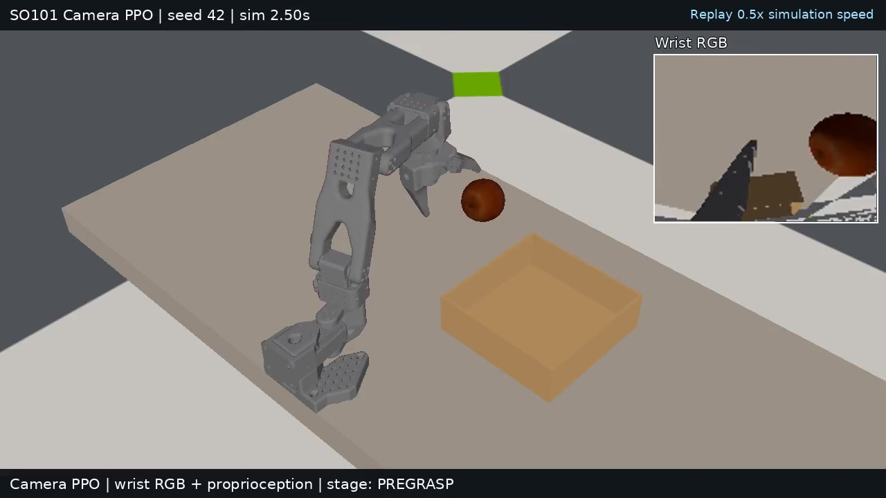
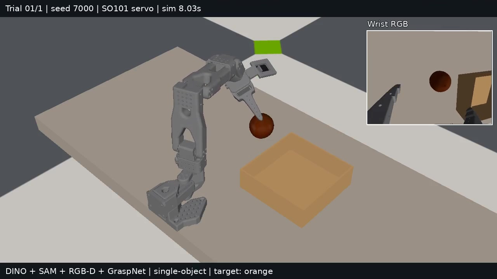
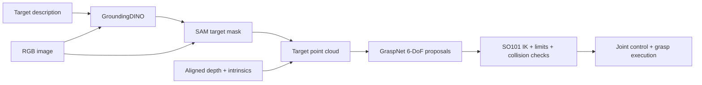

# Pick Anything with SO101

Two approaches to tabletop manipulation with the SO101 arm in Isaac Lab:

- **Reinforcement learning:** train a PPO policy to pick an orange, place it in a tray, and retreat.
- **Language-guided grasping:** turn a target description and RGB-D observation into a segmented point cloud, ranked 6-DoF grasp proposals, and executable robot motions.

Both approaches run in simulation. The language pipeline is independent of the PPO policies and does not require PPO training.

## Demos

Click a preview to open its MP4. These are demonstration clips, not success-rate benchmarks.

| Reinforcement learning | Language-guided grasping |
| :---: | :---: |
| [](media/rl_grasp.mp4) | [](media/language_grasp.mp4) |
| Camera policy: grasp, lift, transport, and place. | GroundingDINO + SAM + GraspNet + SO101 execution. |

## How it works



GroundingDINO supplies a target region; SAM supplies an instance mask. GraspNet supplies grasp position, orientation, opening width, and score. The controller converts a feasible grasp into joint commands. A 2-D box center is never treated as an executable grasp pose.

## Requirements

The development setup uses Linux, an NVIDIA GPU, Python 3.12, **Isaac Sim 6.1**, and an **Isaac Lab 3.0 development source checkout with the Newton backend**. It uses Conda and pip.

| Component | Version observed in the development environment |
| --- | --- |
| Python | 3.12 |
| Isaac Sim | 6.1.0.0 |
| Isaac Lab checkout | `VERSION=3.0.0`, local revision `552e9a6bedd60b996d2f70a2e6f4926fd1eed9b0` |
| PyTorch / torchvision | 2.11.0+cu128 / 0.26.0+cu128 |
| Newton | 1.6.0rc1 |
| RSL-RL | 5.5.1 |
| Transformers | 5.10.4 |

The Isaac Lab revision identifies the local development setup; its availability from the public upstream repository has not been verified. The project requires `isaaclab_newton` and the unified `isaaclab_rl.entrypoints` API. An older Isaac Lab 2.x installation is not a drop-in replacement. Installed package metadata may differ from the checkout's `VERSION` file.

## Installation

### 1. Create the Conda environment

```bash
conda create -n isaaclab_61 python=3.12 -y
conda activate isaaclab_61
python -m pip install --upgrade pip
```

### 2. Install the simulator and a compatible Isaac Lab checkout

Follow the [Isaac Lab installation documentation](https://isaac-sim.github.io/IsaacLab/develop/source/setup/installation/index.html) for driver and platform requirements. Use a checkout supporting Isaac Sim 6.1, Newton, and the unified RL entrypoints above, with all packages in the same Conda environment.

For the pip-based simulator installation:

```bash
python -m pip install "isaacsim[all,extscache]==6.1.0.0" \
  --extra-index-url https://pypi.nvidia.com
```

Set `ISAACLAB_ROOT` to your compatible source checkout. Install its backend dependencies according to its metadata, then its source packages. For the development layout used here:

```bash
export ISAACLAB_ROOT=/absolute/path/to/IsaacLab
python -m pip install torch==2.11.0 torchvision==0.26.0 \
  --index-url https://download.pytorch.org/whl/cu128
python -m pip install "newton[sim]==1.6.0rc1" rsl-rl-lib==5.5.1
python -m pip install \
  -e "$ISAACLAB_ROOT/source/isaaclab" \
  -e "$ISAACLAB_ROOT/source/isaaclab_assets" \
  -e "$ISAACLAB_ROOT/source/isaaclab_newton" \
  -e "$ISAACLAB_ROOT/source/isaaclab_ov" \
  -e "$ISAACLAB_ROOT/source/isaaclab_physx" \
  -e "$ISAACLAB_ROOT/source/isaaclab_visualizers" \
  -e "$ISAACLAB_ROOT/source/isaaclab_rl" \
  -e "$ISAACLAB_ROOT/source/isaaclab_tasks"
```

These commands document the source-package layout; a clean-machine installation has not yet been validated. Use the compatible checkout's USD provider and backend dependencies rather than mixing arbitrary USD wheels.

### 3. Set up this repository

```bash
git clone https://github.com/Kraziee-AI/Pick_Anything.git
cd Pick_Anything
python -m pip install -r requirements.txt
export ISAACSIM_ASSET_ROOT="$PWD/assets/isaac_cache"
export PYTHONDONTWRITEBYTECODE=1
python scripts/cache_training_assets.py
```

Run commands from the repository root. Set the environment variables again in each new terminal. Asset preparation downloads missing original simulator assets into this repository and skips existing files.

### 4. Prepare the language models

The runtime loads weights **offline**. Download the detector and segmenter once before inference:

```bash
python - <<'PY'
from pathlib import Path
from huggingface_hub import snapshot_download

root = Path.cwd()
snapshot_download(
    "IDEA-Research/grounding-dino-tiny",
    cache_dir=root / "outputs/grounded_pick/cache/huggingface",
)
snapshot_download(
    "facebook/sam-vit-base",
    revision="70c1a07f894ebb5b307fd9eaaee97b9dfc16068f",
    local_dir=root / "small_grasp/models/sam-vit-base",
)
PY
```

Model sources: [GroundingDINO Tiny](https://huggingface.co/IDEA-Research/grounding-dino-tiny), [SAM ViT-B](https://huggingface.co/facebook/sam-vit-base), and [GraspNet baseline](https://github.com/graspnet/graspnet-baseline). The local GraspNet implementation uses PyTorch PointNet2 operations and does not require compiling separate PointNet2 CUDA extensions.

The expected grasp checkpoint is `small_grasp/models/graspnet_epoch18.tar`, SHA-256:

```text
60680087c61cba2b6791614fef1519071e294f6dcaf99b3f581bb95f7c51a868
```

Use this checkpoint for the documented setup. The default path enforces its hash; a different checkpoint can be supplied explicitly to offline inference. SAM and detector caches are excluded from source uploads.

## Reinforcement learning

The historical task IDs contain `Apple`; the current staged RL target is an **orange**.

| Route | Task ID | Actor input |
| --- | --- | --- |
| State PPO | `Pick-Apple-SO101-Staged-v0` | State and motion history |
| Camera PPO | `Pick-Apple-SO101-Staged-Camera-v8` | Wrist RGB and proprioception |
| Teacher-to-camera distillation | `Pick-Apple-SO101-Staged-Camera-Distill-v10` | Student RGB and proprioception |

Camera PPO uses privileged information in its training critic; its actor uses RGB and proprioception. Distillation requires a compatible trained state teacher and is optional.

### Train PPO

```bash
# State policy
python scripts/train_pick.py --rl_library rsl_rl \
  --task Pick-Apple-SO101-Staged-v0 \
  --num_envs 4096 --device cuda:0 --seed 42 \
  --max_iterations 13000 --viz none --run_name state_ppo

# Camera policy
python scripts/train_pick.py --rl_library rsl_rl \
  --task Pick-Apple-SO101-Staged-Camera-v8 \
  --num_envs 512 --device cuda:0 --seed 42 \
  --max_iterations 12000 --viz none --run_name camera_ppo
```

Reduce `--num_envs` for smaller GPUs. Checkpoints and TensorBoard logs are written under `logs/rsl_rl/`. Retain `reset_states/pick_orange_bank_v1.pt`, the reset bank used by staged training.

Resume a compatible policy by adding `--checkpoint /absolute/path/to/model.pt`. `--max_iterations` specifies the additional iterations for that run.

### Run a trained policy

The archived camera checkpoint is `models/camera_ppo/2026-10-12_15-10-13_camera_stage_recovery_v2/model_17596.pt`.

```bash
export LD_PRELOAD="$CONDA_PREFIX/lib/python3.12/site-packages/nvidia/cuda_runtime/lib/libcudart.so.12"
python scripts/play_pick.py --rl_library rsl_rl \
  --task Pick-Apple-SO101-Staged-Camera-v8 \
  --num_envs 1 --device cuda:0 --seed 42 --viz kit --real-time \
  --checkpoint models/camera_ppo/2026-10-12_15-10-13_camera_stage_recovery_v2/model_17596.pt
```

State playback uses the state task ID and a matching state checkpoint. Do not interchange state, camera, and distilled checkpoints.

### Record a PPO demonstration

Install the system `ffmpeg` executable, then record one complete episode with a passive overview camera and wrist-camera inset:

```bash
PICK_RL_DEMO_OUTPUT="$PWD/outputs/rl_demo/demo.mp4" \
python scripts/play_pick.py --rl_library rsl_rl \
  --task Pick-Apple-SO101-Staged-Camera-v8 \
  --num_envs 1 --device cuda:0 --seed 42 --viz none \
  --checkpoint models/camera_ppo/2026-10-12_15-10-13_camera_stage_recovery_v2/model_17596.pt \
  --external_callback scripts.record_rl_demo.install_recorder
```

The recorder stops at the first original task termination or 2700 control steps. It reports the original termination reason and does not retry or override policy actions. It adds an observer camera and uses the existing visual-only tray USD so Newton renders the tray; the tray's original physics is referenced unchanged. This is a presentation configuration, not a benchmark. `PICK_RL_DEMO_MAX_STEPS` changes the duration cap. The Newton-camera recorder avoids Kit viewport capture and does not require MoviePy.

### Evaluate from HOME

```bash
python scripts/eval_pick_home.py --rl_library rsl_rl \
  --task Pick-Apple-SO101-Staged-Camera-v8 \
  --num_envs 256 --device cuda:0 --viz none --seed 42 \
  --checkpoint models/camera_ppo/2026-10-12_15-10-13_camera_stage_recovery_v2/model_17596.pt \
  --external_callback scripts.eval_pick_home.install_episode_counter
```

Each environment contributes its first full episode from HOME. A historical camera PPO evaluation recorded **474/512 successes (92.58%)**, across seeds 42 and 43 in the tested simulation distribution. This measures placement and retreat, not arbitrary-object or real-hardware performance.

## Language-guided grasp inference

### Run the SO101 simulation pipeline

```bash
python -B -m small_grasp.pick \
  --instruction "orange" --scene object-single --controller servo \
  --segmentation-backend sam --arm-tracking-feedback \
  --candidate-contact-ranking --candidate-contact-policy band_first \
  --wrist-camera-profile open-jaws --network-frame legacy-optical \
  --network-region target-mask --candidate-pool-size 100 \
  --record-video --output-dir small_grasp/outputs/orange_demo
```

Use a new output directory each time. Registered `object-single` targets are `orange`, `apple`, `pear`, and `blue cube`. This entrypoint evaluates grasping and end hold, not placement. The older `single` and `multi` physical entrypoints remain orange-specific.

The command explicitly selects evaluated settings; they are not all CLI defaults. `--width-scale 10` is the current compatibility setting, not a calibrated mapping from parallel-gripper width to the SO101 jaw angle.

Add `--close-frame-policy reachable-line` to try experimental robot-feasible closure compensation. It remains opt-in: its new 40-trial evaluation is incomplete, and it has not demonstrated a per-class 70% result.

### View detection, masks, and grasp directions

Add `--live-debug --live-debug-port 8765` to the simulation command, then open `http://127.0.0.1:8765` while it runs. The local viewer shows scene RGB, wrist-camera detection and SAM results, and candidate pose overlays. Perception has processing latency; overlays identify their source frame.

### Infer from your own RGB-D files

```bash
python -B -m small_grasp.infer \
  --rgb /path/to/rgb.png --depth /path/to/depth.png \
  --intrinsics /path/to/intrinsics.json \
  --instruction "yellow pear" --mask-backend dino \
  --segmentation-backend sam --device cuda:0 \
  --output-dir small_grasp/outputs/pear_rgbd
```

Example intrinsics schema; replace all values with your camera calibration:

```json
{
  "width": 640, "height": 480,
  "fx": 592.566, "fy": 592.566,
  "cx": 319.132, "cy": 246.937,
  "depth_scale": 1000.0
}
```

Depth must be aligned with RGB and represent optical-axis Z depth. Use `depth_scale=1000` for integer millimeters or `1` for floating-point meters. The optical frame is +X right, +Y down, +Z forward. Candidate transforms are not SO101 TCP commands; calibrated frame conversion and robot feasibility checks are required.

This module supports pretrained grasp inference, not GraspNet training. Training a new grasp model requires its upstream dataset and training implementation.

### Outputs and evaluation scope

Runs save detection metadata, masks, point clouds, candidate IDs and SE(3) poses, overlays, execution traces, and optional MP4 videos. Candidate generation alone is not grasp success. Ground truth is reserved for explicitly separate diagnostics and scoring.

The earlier fixed-policy evaluation used ten opportunities per class. Its independent pad-midpoint V2 metric recorded:

| Object | Grasp and lift | End hold |
| --- | ---: | ---: |
| Orange | 9/10 | 8/10 |
| Apple | 9/10 | 8/10 |
| Pear | 6/10 | 6/10 |
| Blue cube | 5/10 | 4/10 |

V1 and V2 use different gripper distance references and remain separate. These results use a different task and distribution from PPO; the percentages are not directly comparable. They do not establish arbitrary-object grasping or real-robot readiness.

Checks cover robot limits and sampled gripper-mesh clearance along planned motions. Optional arm-capsule checks remain experimental. This is not a complete all-link or continuous collision planner; held-object and occluded-space coverage remain limited.

## Repository layout

```text
assets/          Robot, object, scene, and local simulator assets
pick_anything/   RL tasks, observations, rewards, and registration
scripts/         Training, playback, evaluation, and asset utilities
small_grasp/     Grounding, segmentation, grasp inference, and execution
reset_states/    Reset bank for staged RL training
models/          Selected archived camera PPO checkpoint
media/           Homepage videos and preview images
requirements.txt Project additions to the compatible simulator environment
```

Experiment outputs, caches, personal notes, and change records are excluded from the public source package. `scripts/prepare_github_release.py` audits and exports a clean snapshot without changing Git's index or deleting local files.

## Acknowledgments and third-party terms

Built on [Isaac Lab](https://github.com/isaac-sim/IsaacLab), [Newton](https://github.com/newton-physics/newton), [RSL-RL](https://github.com/leggedrobotics/rsl_rl), [leisaac](https://github.com/LightwheelAI/leisaac), [GroundingDINO](https://github.com/IDEA-Research/GroundingDINO), [Segment Anything](https://github.com/facebookresearch/segment-anything), and [GraspNet](https://github.com/graspnet/graspnet-baseline). The local grasp implementation was adapted through [OVGNet](https://github.com/cv516Buaa/OVGNet).

Third-party code, assets, and weights retain their own terms. In particular, the GraspNet-derived vendor code carries the noncommercial research terms in `small_grasp/vendor/LICENSE`; this repository does not relicense those components under a blanket permissive license.
